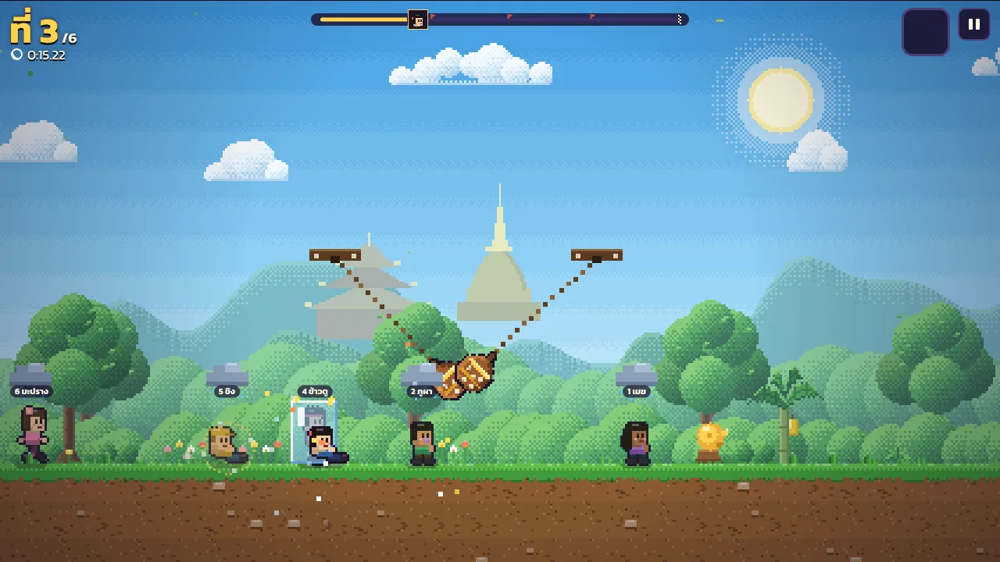
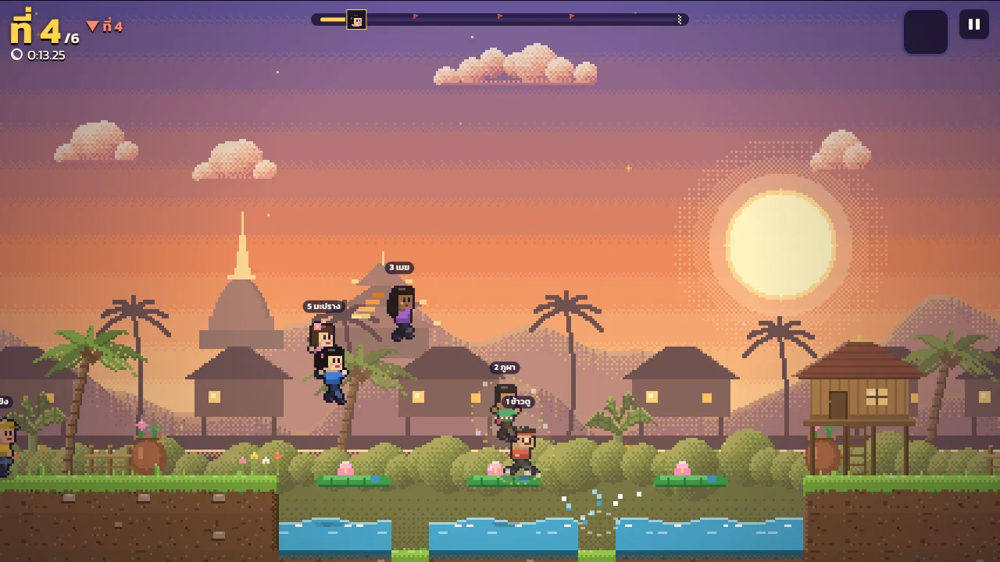
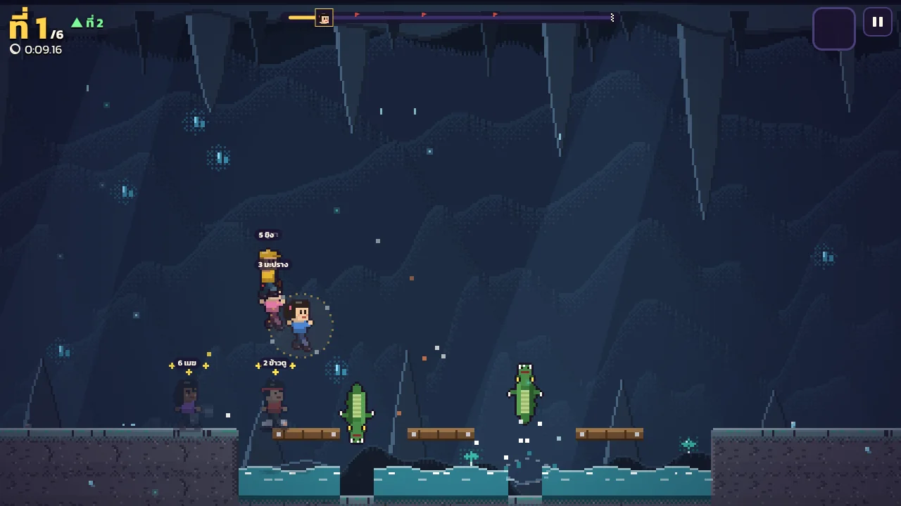
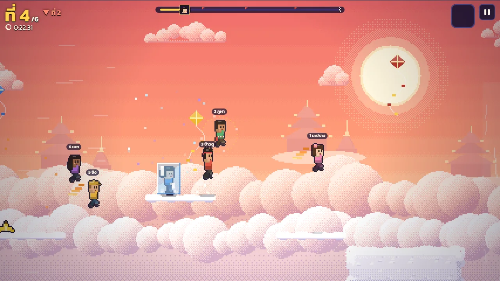
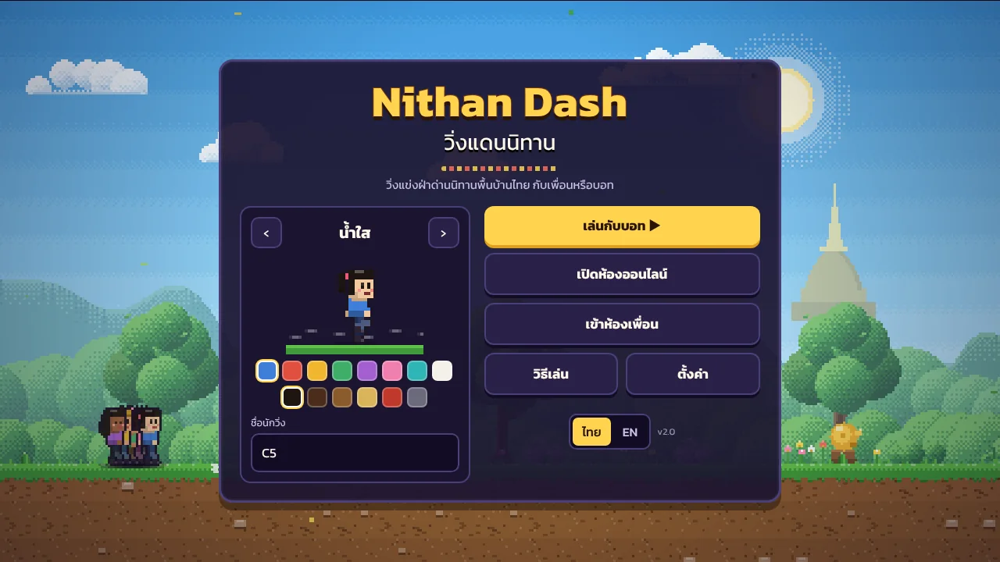
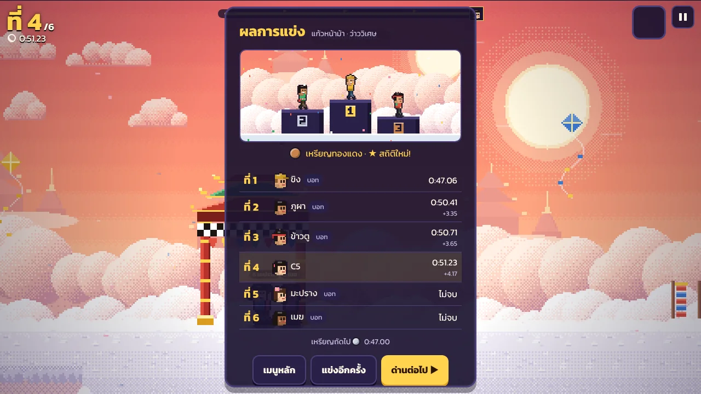

# วิ่งแดนนิทาน · Nithan Dash

เกมวิ่งแข่งฝ่าด่านแบบพิกเซล ในโลกนิทานพื้นบ้านไทย แข่งกับบอทหรือชวนเพื่อนอีก 3 คนมาแข่งออนไลน์ เล่นได้ในเบราว์เซอร์ทั้งคอมและมือถือ สลับภาษาไทย / English ได้

A pixel-art racing platformer through Thai folk tales. Race the bots or up to three friends online, right in the browser on desktop or phone, in Thai or English.

**▶ เล่นเลย / Play:** https://realceedc5.github.io/nithan-dash/

| | |
|---|---|
|  |  |
| สังข์ทอง · Sang Thong | ปลาบู่ทอง · The Golden Goby |
|  |  |
| ไกรทอง · Krai Thong | แก้วหน้าม้า · Kaew Na Ma |
|  |  |
| หน้าแรก · Title | ผลการแข่ง · Results |

---

## ภาษาไทย

### ใหม่ในเวอร์ชัน 2.0
รอบนี้ยกคุณภาพทั้งเกม ด่านและระบบแข่งเดิมยังอยู่ครบ
- **ภาพใหม่ทั้งหมด** ท้องฟ้าไล่สีแบบพิกเซล ฉากหลังซ้อนชั้นมีมิติของแต่ละเรื่อง (ภูเขากับเจดีย์ทอง หมู่บ้านริมคลองยามเย็น ถ้ำหินย้อยมีผลึกเรืองแสง ทะเลเมฆกับปราสาทลอยฟ้า) พื้นดินมีหญ้า ขอบ และเงาลึก ต้นไม้ บ้านเรือนไทย และของประดับวาดใหม่หมด
- **ตัววิ่งและอุปสรรควาดใหม่** ท่าวิ่ง 8 เฟรม กะพริบตา มีเงาบนพื้น กระบองยักษ์ ระฆัง สากตำข้าว หินหน้ายักษ์ จระเข้ ปลาบู่ทอง ลูกกลิ้งแต่ละด่านมีหน้าตาของตัวเอง
- **รู้สึกดีขึ้นตอนเล่น** กล้องมองล่วงหน้า จอสั่นเมื่อโดนชน ตัวยืดหดตอนกระโดดและลงพื้น ฝุ่น วงแหวน ภาพติดตาตอนเร่ง เส้นความเร็ว ใบไม้ หิ่งห้อย น้ำหยด และสายลมประจำด่าน
- **อุปสรรคเตือนก่อน** สากสั่นและขึ้นเครื่องหมายก่อนทุบ มีฟองน้ำก่อนจระเข้โผล่ มีเงาบนพื้นใต้ลูกตุ้ม และได้ยินเสียงตามระยะ
- **ออกตัวสุดยอด** กดวิ่งทันทีก่อนขึ้น "ไป!" จะพุ่งออกตัว · **แรงลมดูด** วิ่งจี้ท้ายคนข้างหน้าสักพักจะเร็วขึ้น
- **เหรียญรางวัล** แต่ละด่านมีเวลาเป้าหมายของเหรียญทองแดง เงิน และทอง
- **HUD และเมนูใหม่** แถบระยะทางพร้อมธงเช็กพอยต์ วงล้อสุ่มไอเทม แจ้งเตือนเมื่อแซงหรือถูกแซง หน้าผลการแข่งมีโพเดียมและเวลาห่างจากที่หนึ่ง หน้าเลือกด่านเป็นภาพจริงของด่าน
- **เพลงและเสียงใหม่** เพลงประจำด่านเล่นด้วยเสียงระนาด ขิม ขลุ่ย ฉิ่ง และกลอง เร่งจังหวะช่วงท้ายสนาม เสียงเอฟเฟกต์ใหม่ทั้งชุด ปรับระดับเพลงกับเสียงแยกกันได้
- **ตั้งค่า** ระดับเสียง จอสั่น ภาษา และเต็มจอ

### ด่านนิทาน 4 เรื่อง
| ด่าน | ฉาก | ระวัง |
|---|---|---|
| **สังข์ทอง** | ป่าและบ่อทองคำ | กระบองยักษ์แกว่ง หอยสังข์กลิ้ง |
| **ปลาบู่ทอง** | หมู่บ้านริมคลองยามเย็น | สากตำข้าว ใบบัวที่จมได้ โคลน |
| **ไกรทอง** | ถ้ำชาละวันใต้แม่น้ำ | จระเข้โผล่จากน้ำ หินย้อยแกว่ง ก้อนหินกลิ้ง |
| **แก้วหน้าม้า** | บนฟ้าเหนือเมฆ | เหวระหว่างเมฆ ว่าวที่ลอยขึ้นลง ลมพัดขึ้นช่วยพาข้าม |

### วิธีเล่น
| | คอมพิวเตอร์ | มือถือ |
|---|---|---|
| วิ่ง | ← → หรือ A D | ปุ่มซ้ายขวาด้านซ้าย |
| กระโดด | Space / ↑ / W (กดอีกครั้งกลางอากาศ = กระโดด 2 ชั้น) | ปุ่มใหญ่ด้านขวา |
| สไลด์ / มุดลอด | ↓ / S | ปุ่มลง |
| ใช้ไอเทม | E / Shift | ปุ่มไอเทม |
| กลับเช็กพอยต์ | R | ในเมนูหยุดเกม |

### ไอเทม (สุ่มจากกล่อง ?)
ลมกรด (วิ่งเร็วขึ้น) · ผ้ายันต์ (กันโดนชน 1 ครั้ง) · ลูกแก้วสะกด (สะกดคนข้างหน้า) · เปลือกกล้วย (วางให้คนข้างหลังลื่น) · เมฆฝน (ทุกคนข้างหน้าช้าลง) · ปีกครุฑ (บินได้สักพัก ไม่ตกเหว)
คนที่อยู่ท้าย ๆ จะได้ไอเทมช่วยไล่ตามบ่อยกว่า

### เล่นกับเพื่อน
1. คนหนึ่งกด **เปิดห้องออนไลน์** แล้วส่งรหัส 5 ตัวให้เพื่อน
2. เพื่อนกด **เข้าห้องเพื่อน** แล้วใส่รหัส
3. เจ้าของห้องเลือกด่าน เลือกว่าจะเติมบอทให้ครบ 6 คนไหม แล้วกด **เริ่มแข่ง**

---

## English

### New in 2.0
A quality pass over the whole game. The levels and the racing rules are unchanged.
- **All-new art**: dithered pixel skies and layered backdrops for each tale (hills and a golden chedi, a canal village at sunset, a cave of stalactites and glowing crystals, a sea of clouds with floating palaces). The ground has grass, edges and depth, and the trees, stilt houses and decorations are redrawn
- **Redrawn runners and hazards**: an eight-frame run, blinking, ground shadows, and a look of its own for every club, bell, rice pounder, stone face, crocodile, golden goby and roller
- **Better feel**: a camera that looks ahead, screen shake on hits, squash and stretch, dust, rings, afterimages and speed lines when boosting, plus leaves, fireflies, drips and wind for each level
- **Hazards warn you**: crushers shake and flash before they drop, bubbles rise before a crocodile leaps, swinging hazards cast a shadow, and you hear them by distance
- **Perfect start**: press run just before "GO!" for a launch. **Slipstream**: stay close behind another runner for a moment to speed up
- **Medals**: every level has bronze, silver and gold target times
- **New HUD and menus**: a progress bar with checkpoint flags, an item roulette, overtake pop-ups, a results screen with a podium and time gaps, and level cards that show the real level
- **New music and sound**: a tune for each level played on ranat, khim, khlui, ching and drums that picks up pace near the finish, a full new set of sound effects, and separate music and sound volume
- **Settings** for volume, screen shake, language and full screen

### Four folk-tale levels
**Sang Thong** (swinging giant clubs, rolling conch shells) · **The Golden Goby** (rice pounders, sinking lotus pads, mud) · **Krai Thong** (leaping crocodiles in Chalawan's cave) · **Kaew Na Ma** (cloud gaps, bobbing kites, updrafts).

### Controls
Arrows or A / D to run, Space / ↑ / W to jump (again in the air for a double jump), ↓ / S to slide, E / Shift to use an item, R to go back to the last checkpoint. On phones, use the on-screen buttons.

### Items
Whirlwind (speed burst), Yantra Cloth (blocks one hit), Spell Orb (freezes the runner ahead), Banana Peel (drop it behind you), Rain Cloud (slows everyone ahead), Garuda Wings (fly for a moment). Runners near the back get catch-up items more often.

### Online
One player opens a room and shares the 5-letter code; up to 4 players join, and bots can fill the race to 6 runners.

---

## How it works

- **Clock-driven hazards.** Every swinging club, crusher, crocodile and moving platform is a pure function of the race clock, so all players see the same hazards without sending them over the network.
- **Peer-to-peer races.** Rooms use WebRTC through PeerJS. The host keeps the lobby, runs the bots and decides the results; each player simulates their own runner and shares its state 15 times a second. Clocks are synced with ping/pong before the start.
- **Bots that plan their jumps.** Bots read the tiles ahead, then fly several candidate jumps through the same physics to choose one that lands on safe ground, including moving platforms at the time they'll arrive.
- **No assets, no build.** All sprites, tiles, backdrops and music are generated in code with Canvas 2D and the Web Audio API. Each level is pre-drawn once into two canvases (behind and in front of the runners), so a frame is mostly a handful of blits.

## Run it locally

```bash
python3 -m http.server 8000
# open http://localhost:8000
```

Online rooms need the page served over HTTPS (GitHub Pages works) and use the free PeerJS cloud server for matchmaking.

## Project structure

```
index.html      HUD, touch buttons, menu styles
js/i18n.js      Thai / English text
js/data.js      runners, items, medal times, themes, level chunks and level order
js/world.js     level building, tiles, clock-driven hazards, runner physics
js/art.js       pixel-art helpers, runners, item icons, tiles, decor, the pre-drawn level
js/scene.js     sky, parallax backdrops, water, hazards, platforms, flags, finish gate
js/audio.js     sound effects and the music ensemble
js/race.js      race clock, items, bots, slipstream, ranking, results
js/net.js       online rooms (PeerJS)
js/fx.js        particles, screen shake, ambient life, hazard warnings, reactions
js/ui.js        rendering, camera, input, HUD, menus, main loop
media/          screenshots for this README
```

Made by C5. The tales are traditional Thai folk stories; every character and drawing in the game is original.
